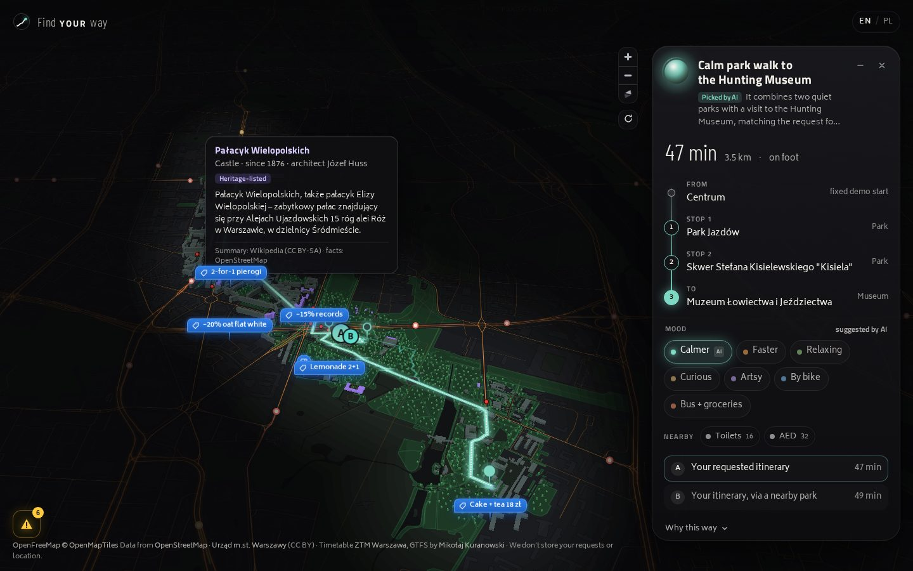
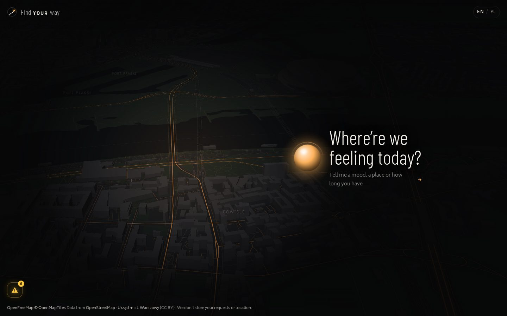
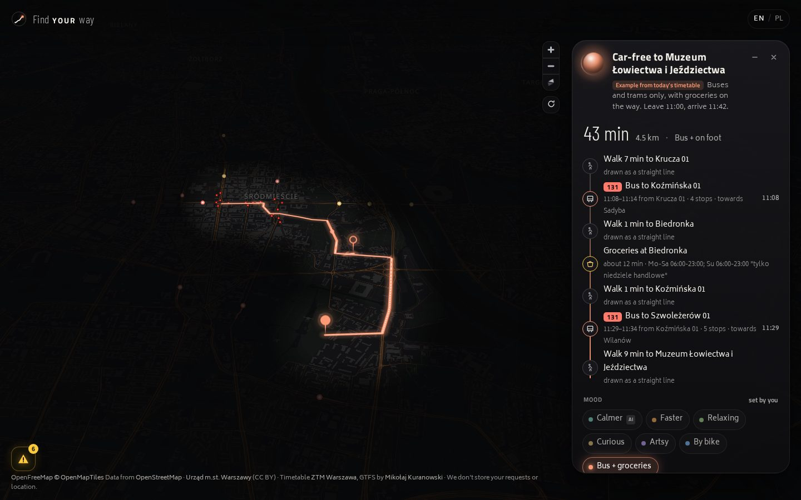

# Find YOUR way

A calm, guided way through Warsaw, built on open data. Tell the guide how you feel, and it finds a
walk through quieter, greener streets, lights up the city along it, and shows what is there to see,
use and catch on the way.

Built in 24 hours for the Warsaw Open Data Hackathon 2026 (Challenge 1: Warsaw 2076).



| Home | Car-free, with groceries on the way |
| --- | --- |
|  |  |

## What it does

- **Ask in your own words.** "Somewhere calm and green, with a museum." A language model picks the best of six
  predefined demo outings for central Warsaw; a real street-routing service draws the route. Without a model
  key, a keyword match picks instead.
- **Switch the mood.** Calmer, Faster, Relaxing, Curious, Artsy, By bike, or **Bus + groceries**: a car-free
  example that uses only buses and trams from today's timetable, with a grocery stop on the way.
- **A quiet map that lights up your way.** A dark city with amber streets. Along the route, and only there:
  3D buildings, parks with trees, culture and history in clay orange. Hover a clay-orange building for its name, age and a
  short Wikipedia summary.
- **What is on the way.** Public transport stops, with buses and trams heading your way moving by their
  timetable; toilets and defibrillators on request; events, offers and tickets as small dark flags.
- **Have your say.** A yellow button collects reports about missing benches, water, toilets or safer crossings.
  Your reports stay in your browser.
- **English and Polish**, on a computer or a phone. An AI agent can use the same planner through MCP.

## Run it with Docker

You need [Docker](https://docs.docker.com/get-docker/) with Compose v2 and an internet connection for the map
tiles. Nothing else: no accounts, no keys.

```bash
git clone https://github.com/Delta-43/1_ft_ddos_waw_open_data_hackathon.git find-your-way
cd find-your-way
docker compose up -d --build
```

Open **http://localhost:4173/?time=11:00** (`?time=11:00` sets the clock so buses and trams are running; leave
it out to use the real time). The first build takes a few minutes; later starts take seconds.

```bash
docker compose ps        # both services should be "healthy"
docker compose logs -f   # follow the logs
docker compose down      # stop
```

Optional settings go in a `.env` file next to `compose.yaml` (copy `.env.example`):

| Setting | Effect |
| --- | --- |
| `OPENROUTER_API_KEY` | The AI picks the outing from your words. Without it, a keyword match does. |
| `LLM_MODEL`, `LLM_DATA_COLLECTION` | Which OpenRouter model; free models need `LLM_DATA_COLLECTION=allow`. |
| `WEB_PORT` | Port of the app (default 4173). |
| `BIND_ADDR` | Address the ports are published on (default `127.0.0.1`, this computer only). To share it on a private network such as Tailscale, use that network's address; never `0.0.0.0` or a public address. |
| `ROUTING_SOURCE` | `cache` (default): the committed street routes first, so the demo works if the routing service is down. `live`: ask the routing service first. |

To host it for others on a Tailscale network, `scripts/demo-up.sh` starts the stack on this machine's
Tailscale address and prints the link. See [docs/DEMO.md](docs/DEMO.md) and [docs/DEPLOYMENT.md](docs/DEPLOYMENT.md).

## What is real, estimated or simulated

The app labels every number with its source. In short:

| Real (from a real source) | Estimated | Simulated or example |
| --- | --- | --- |
| Street routes (OSRM on OpenStreetMap), places, parks, buildings, toilets, defibrillators, shops (OpenStreetMap), timetable (ZTM Warsaw), culture summaries (Wikipedia), one city event (Warsaw open data) | Greenery and quiet scores (from park and main-road distances, not measured), building heights (from floor counts), vehicle positions (interpolated from the timetable, not live GPS) | The six outings are predefined (only the street route is computed); car-free itineraries are precomputed examples for one day; offers, tickets and two events are invented; example reports are invented |

## How it works

```
Browser ── React + MapLibre (dark map, 3D corridor, transit, flags)
   │         static data: corridor-cache.json, transit-cache.json, transit-examples.json
   ▼
nginx (web container) ── /api ──► FastAPI (api container)
                                   ├─ tracks: one model call picks a predefined outing
                                   ├─ planner: stops, opening hours, green and quiet estimates
                                   ├─ routing: OSRM street geometry, with committed cache
                                   └─ SQLite city layers ── also served to AI agents by the MCP server
```

- **Frontend:** React 19, TypeScript, Vite, MapLibre GL JS 6 with OpenFreeMap vector tiles, plain CSS,
  self-hosted fonts. See [frontend/README.md](frontend/README.md).
- **Backend:** Python 3.12, FastAPI, Pydantic, SQLite, HTTPX; OpenRouter for the optional model call; the
  official MCP Python SDK for agents. Contract: [contracts/README.md](contracts/README.md).
- **Data builds:** `scripts/build_corridor_cache.py` (OpenStreetMap and Wikipedia),
  `scripts/build_transit_cache.py` and `scripts/build_transit_examples.py` (GTFS). See
  [docs/DATA.md](docs/DATA.md).

## Develop

Run the backend and the Vite dev server without Docker, run the checks, rebuild the data caches:
[docs/DEVELOPMENT.md](docs/DEVELOPMENT.md).

## Data and licences

Map data © OpenStreetMap contributors (ODbL); tiles by OpenFreeMap and OpenMapTiles; timetable by ZTM Warsaw
(GTFS by Mikołaj Kuranowski); routing by FOSSGIS OSRM; summaries from Wikipedia (CC BY-SA 4.0); city data from
Urząd m.st. Warszawy (CC BY); fonts under the SIL Open Font License. Full list: [NOTICE.md](NOTICE.md).

## Privacy

The backend stores no profiles, preferences or trip history; each request stands alone. Requests are not logged.
Reports and the language choice stay in the visitor's browser.

<!-- team-only:start -->
## Team and process

Delta (backend, integration, pitch), Sonia (data), Alban (map, presentation), Ola (forms, states), Aryna (place
cards, labels). Process documents: [AGENTS.md](AGENTS.md), [PLAN.md](PLAN.md), [docs/DECISIONS.md](docs/DECISIONS.md),
[docs/GITHUB.md](docs/GITHUB.md), [docs/PITCH.md](docs/PITCH.md), [docs/Build_State_For_Pitch.md](docs/Build_State_For_Pitch.md).
Tasks are GitHub issues. The concept and roadmap are in [IDEA.md](IDEA.md).
<!-- team-only:end -->
